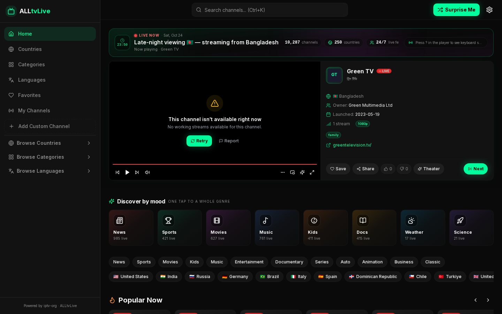
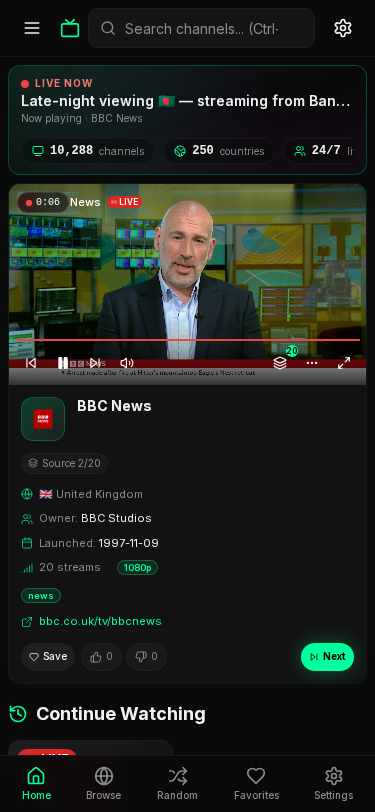

<div align="center">

# 📺 ALLtvLive

### Free Live TV Channels — Anytime, Anywhere

Watch **10,000+** free live TV channels from around the world in one place.

[](https://nextjs.org/)
[](https://typescriptlang.org/)
[](https://tailwindcss.com/)
[](#license)
[](https://github.com/SahinurDEV/ALLtvLive)
[](https://alltvlive.vercel.app)

**[🔴 Live Demo → alltvlive.vercel.app](https://alltvlive.vercel.app)**

---

</div>

## ✨ Features

| Feature | Description |
|---|---|
| **Live Streaming** | HLS video player with play/pause, volume, PiP, and fullscreen |
| **10,000+ Channels** | Aggregates public IPTV streams from [iptv-org](https://github.com/iptv-org/iptv) |
| **Country Detection** | Auto-detects your country and shows local channels first |
| **Auto-Play** | Randomly plays a channel from your country on page load |
| **Smart Search** | Fuzzy search powered by Fuse.js across all channels |
| **Browse & Filter** | Filter by country, category, and language |
| **Favorites** | Save channels to your favorites (persisted in localStorage) |
| **Responsive** | Fully responsive — mobile, tablet, and desktop |
| **Dark/Light Theme** | Neon dark theme by default with light mode toggle |
| **Rich Channel Info** | Network, owner, languages, launch date, website, stream quality |
| **Smart Source Fallback** | Tries every stream of a channel, skips refused (403) sources, upgrades `http://` to `https://` |
| **Admin Dashboard** | `/admin`: stream health, reports, ratings, watch analytics, featured channels (needs MongoDB) |
| **Copyright & Takedown** | `/dmca` page, takedown issue template and a channel blocklist (`lib/blocklist.ts`) |
| **SEO** | Real `robots.txt`, sitemap of every channel, canonical URLs, JSON-LD, proper 404s |

## 🖼️ Screenshots

| Desktop | Mobile (375 px) |
|---|---|
|  |  |

## 🛠️ Tech Stack

- **Framework:** [Next.js 15.5](https://nextjs.org/) (App Router)
- **Language:** [TypeScript](https://typescriptlang.org/)
- **Styling:** [Tailwind CSS](https://tailwindcss.com/) + [shadcn/ui](https://ui.shadcn.com/)
- **State:** [Zustand](https://zustand-demo.pmnd.rs/)
- **Data Fetching:** [SWR](https://swr.vercel.app/)
- **Video:** [HLS.js](https://github.com/video-dev/hls.js/)
- **Search:** [Fuse.js](https://www.fusejs.io/)
- **Animations:** [Framer Motion](https://www.framer.com/motion/)
- **Icons:** [Lucide React](https://lucide.dev/)
- **Deployment:** [Vercel](https://vercel.com/)

## 📁 Project Structure

```
alltvlive/
├── app/
│   ├── layout.tsx          # Root layout with theme provider
│   ├── page.tsx            # Homepage — player + channel grid
│   ├── [channel]/page.tsx  # Dynamic channel route
│   └── globals.css         # Theme variables & global styles
├── components/
│   ├── InlinePlayer.tsx    # Video player with HLS + controls
│   ├── ChannelCard.tsx     # Channel card component
│   ├── ChannelGrid.tsx     # Grid with load-more pagination
│   ├── Sidebar.tsx         # Navigation sidebar
│   ├── Navbar.tsx          # Top bar with search
│   ├── MobileNav.tsx       # Bottom nav for mobile
│   ├── FavoritesView.tsx   # Favorites page
│   └── ui/                 # shadcn/ui components
├── hooks/
│   └── useChannels.ts      # Main data hook (SWR + Fuse.js)
├── lib/
│   ├── api.ts              # API fetching functions
│   ├── store.ts            # Zustand global state
│   ├── types.ts            # TypeScript interfaces
│   └── utils.ts            # Utility functions
└── public/
    └── manifest.json       # PWA manifest
```

## 🚀 Getting Started

### Prerequisites

- **Node.js** 20+
- **npm** or **yarn**

### Installation

```bash
# Clone the repository
git clone https://github.com/SahinurDEV/ALLtvLive.git
cd ALLtvLive

# Install dependencies
npm install

# Start development server
npm run dev
```

Open [http://localhost:3000](http://localhost:3000) in your browser.

### Build for Production

```bash
npm run build
npm start
```

## 🌐 Deploy to Vercel

The easiest way to deploy ALLtvLive:

1. Push this repo to GitHub
2. Go to [vercel.com/new](https://vercel.com/new)
3. Import your repository
4. Click **Deploy**

The public site needs no environment variables. The optional ones turn on extra features:

| Variable | Purpose |
|---|---|
| `MONGODB_URI`, `MONGODB_DB` | Admin dashboard, stream health, reports, ratings, history |
| `ADMIN_PASSWORD`, `SESSION_SECRET` | Admin sign-in (`SESSION_SECRET`: 32+ random hex chars) |
| `ADMIN_TOTP_SECRET` | Optional 6-digit authenticator code at admin sign-in |
| `IP_HASH_SALT` | Salt for hashed voter IPs (defaults to `SESSION_SECRET`) |
| `CRON_SECRET` | Required for the daily dead-channel check (`/api/cron/stream-check`, scheduled in `vercel.json`). Vercel sends it automatically. Channels that fail 3 daily checks in a row are hidden until a check succeeds again; geo-blocked (403/451) results never count. |
| `NEXT_PUBLIC_SITE_URL` | Canonical URL for robots.txt and the sitemap (default `https://alltvlive.vercel.app`) |
| `NEXT_PUBLIC_ADSENSE_CLIENT_ID` | Google AdSense publisher ID; ads render only when set |

See `.env.example`.

[](https://vercel.com/new/clone?repository-url=https://github.com/SahinurDEV/ALLtvLive)

### Domains, environment fallbacks and cron

- **Canonical domain.** Without `NEXT_PUBLIC_SITE_URL`, canonical links, the sitemap, robots.txt and share cards use `https://livetv.sahinur.dev`, so both domains point search engines at the same URLs.
- **Redirecting alltvlive.vercel.app.** Not done in code on purpose: a redirect would push apps already installed (PWA) from `alltvlive.vercel.app` out of app mode. To turn it on, use Vercel → Project → Settings → Domains → `alltvlive.vercel.app` → *Redirect to* `livetv.sahinur.dev` (308).
- **Cron without `CRON_SECRET`.** `/api/cron/stream-check` then accepts Vercel Cron's own user agent, but runs at most once every 20 hours. Setting `CRON_SECRET` is still recommended; then only `Authorization: Bearer <secret>` works.

## 📡 Data Source

ALLtvLive uses the public APIs provided by [iptv-org](https://github.com/iptv-org/iptv):

| API Endpoint | Description |
|---|---|
| `channels.json` | Channel metadata (name, country, categories) |
| `streams.json` | Stream URLs (HLS, MPEG-TS) |
| `logos.json` | Channel logos |
| `countries.json` | Country list with flags |
| `categories.json` | Channel categories |
| `languages.json` | Language list |

The server trims these into `/api/catalog/{channels,streams,logos}`, which hold only playable, non-blocked channels and one logo each (about 1 MB gzipped instead of about 17 MB), regenerated hourly. If that fails, the browser falls back to iptv-org directly.

## 🧪 Tests and CI

GitHub Actions runs a typecheck, a production build, `npm audit` and Playwright smoke tests at desktop and 375 px on every pull request.

```bash
npm run build
npx playwright install chromium
npm run test:e2e
```

## ⌨️ Keyboard Shortcuts

| Key | Action |
|---|---|
| `Space` | Play / Pause |
| `M` | Mute / Unmute |
| `F` | Toggle Fullscreen |
| `↑` / `↓` | Volume Up / Down |
| `N` / `Page Down` | Next channel (TV remotes: Channel Down) |
| `P` / `Page Up` | Previous channel (TV remotes: Channel Up) |
| `L` | Back to the last channel you watched |
| `T` | Theater mode |
| `?` | Show all shortcuts |
| `Ctrl+K` | Focus Search |

## 🌐 Similar Projects

- [Global Free TV](https://www.globalfreetv.com/) - 7000+ free live TV channels from 150+ countries
- [Squid TV](https://squidtv.net/) - Global TV directory

## 🤝 Contributing

Contributions are welcome! Feel free to open issues or submit pull requests.

1. Fork the repository
2. Create your feature branch (`git checkout -b feature/amazing-feature`)
3. Commit your changes (`git commit -m 'Add amazing feature'`)
4. Push to the branch (`git push origin feature/amazing-feature`)
5. Open a Pull Request

## 📄 License

This project is licensed under the MIT License. See the [LICENSE](LICENSE) file for details.

## ⚠️ Disclaimer

ALLtvLive does not host or provide any video content. It aggregates publicly available IPTV streams indexed by the [iptv-org](https://github.com/iptv-org/iptv) project. All streams are provided by third parties and may be subject to their respective terms of service. A listing does not mean anyone has a license for it. Rights holders can request removal at [/dmca](https://alltvlive.vercel.app/dmca). The MIT license covers this app's code only, not any broadcast content.

---

<div align="center">

**Built with ❤️ by [SahinurDEV](https://github.com/SahinurDEV)**

[GitHub](https://github.com/SahinurDEV/ALLtvLive) · [Live Demo](https://alltvlive.vercel.app) · [Report Bug](https://github.com/SahinurDEV/ALLtvLive/issues)

</div>

## Not yet available

- **Android TV / Play Store release**: not done yet. It needs a Play Console account, and the Expo dependencies need upgrading (`npm ci` in `mobile/` currently fails with ERESOLVE).
- **User accounts / cloud sync**: not built. Until then, go to Settings → Backup to export or import your favorites, history, custom channels and settings as a JSON file.
